---
jupyter:
  jupytext:
    cell_metadata_filter: -all
    split_at_heading: true
    text_representation:
      extension: .md
      format_name: markdown
      format_version: '1.3'
      jupytext_version: 1.18.1
  kernelspec:
    display_name: Python 3 (ipykernel)
    language: python
    name: python3
---

<style>
body {
  font-size: 18px;
  line-height: 1.8;
  color: #333;
}

h1 {
  color: #2c7be5;
  border-bottom: 2px solid #eee;
  padding-bottom: 5px;
}

h2 { color: #e5533d; }
h3 { color: #2fa84f; }

.highlight {
  color: #d63384;
  font-weight: bold;
}

.note {
  background: #f8f9fa;
  border-left: 5px solid #2c7be5;
  padding: 10px;
  margin: 10px 0;
}

.warning {
  background: #fff3cd;
  border-left: 5px solid #ffc107;
  padding: 10px;
}

.code-desc {
  color: #6c757d;
  font-size: 16px;
}

figure {
  margin: 16px 0;
  text-align: center;
}

figcaption {
  color: #6c757d;
  font-size: 16px;
  line-height: 1.5;
}

ul > li,
ol > li {
  font-size: 18px;
  font-weight: bold;
  color: #2c7be5;
}

ul ul li,
ol ol li,
ul ol li,
ol ul li {
  font-size: 18px;
  font-weight: normal;
  color: #333;
}
</style>

# 信息的表示与数字化

[Home]( ../README.md )

## 本章学习的目的

没有信息层对二进制的定义，硬件就没有运算的对象，软件就没有处理的实体，网络就没有传输的内容——它是整个数字世界赖以建立的“第一因”。

所以在计算系统的洋葱模型中，信息层处在最里面的位置。

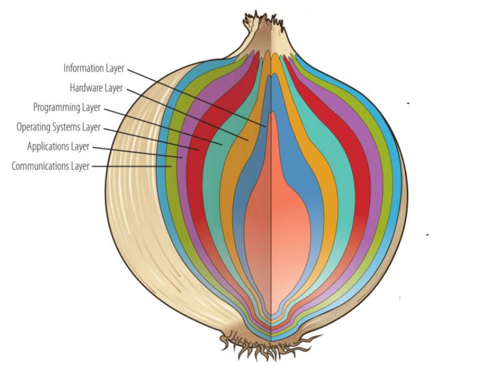

“信息的表示”是一个总问题：计算机如何表示数字、文字、声音和图像？本章先以“数的表示”为主要内容，讨论数制、数制转换、二进制运算以及整数和浮点数的表示。掌握这一基础之后，再将视野扩展到文字、声音、图像等信息的数字化，因为它们最终也要转换成由数值组成的二进制数据，才能被计算机存储、处理和传输。

本章以“数的表示”为切入点，逐步扩展到信息数字化，并建立从表示、运算到抽象建模的基本认识。具体学习目标如下：

<!-- SLIDE -->


1. 弄清楚“数的表示”是编程的基础

    * 计算机的硬件（晶体管、电路）只能区分有限状态，最基本的是 **0 和 1**。
    * 这意味着任何信息（数字、文字、声音、图像）都必须 **转换为二进制形式** 才能被存储和处理。
    * 所以要理解计算机如何工作，首先要弄明白“数在计算机里是怎么表示的”。

<!-- SLIDE -->

2. 表示方式影响精度和范围

    * **整数**：用补码表示，能避免符号位的麻烦，也决定了取值范围（例如 32 位整数范围是 −2³¹ ~ 2³¹−1）。
    * **小数/实数**：计算机采用浮点数标准（IEEE 754），但浮点数有精度限制，导致 `0.1+0.2≠0.3` 这样的现象。
    * 如果不了解这些，就很难理解程序中的“奇怪 bug”。


<!-- SLIDE -->

3. 数字化是信息处理的基础

    * 不只是数值，**声音、图像、视频、文字**等信息也需要数字化（采样、量化、编码），才能进入计算机处理。
    * 比如：

      * 声音 → 采样率 & 位深度
      * 图像 → 像素矩阵 + 颜色编码
    * 这些背后依然是“数的表示”的问题。

<!-- SLIDE -->


4. 算法与效率依赖表示方法

    * 不同的数表示方式影响运算速度和复杂度。
    * 举例：

      * 十进制下做除法比较复杂，但在二进制里除以 2 只要右移一位。
      * 大整数（比如密码学中的 1024 位数）需要特别的存储和运算方法。


<!-- SLIDE -->

5. 培养抽象思维

    * 从“现实世界的数”到“计算机里的比特串”，这是一个 **抽象建模** 的过程。
    * 学会这种思维方式，后面在学习编译、网络、数据库等课程时，就能更好地理解“抽象层次”的概念。

    **讨论信息的表示与数字化，是计算机科学的起点**。它告诉我们：

    * 计算机能处理什么信息；
    * 信息是如何存进去、算出来的；
    * 为什么会有限制、误差和 bug。


<!-- SLIDE -->

## 数制和数制转换

### 什么是数制？

- 数制也称计数制，是指用一组固定的符号和规则来表示数值的方法
- 进位计数制
  - 使用进位的方式进行计数的方法
  - 我们最常见的“十进制”

<figure>

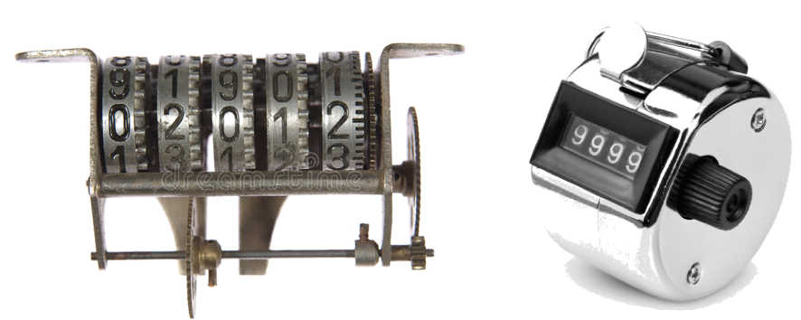

<figcaption>习惯的“0～9”十进制计数</figcaption>

</figure>

<!-- SLIDE -->

#### 更多的计数方法

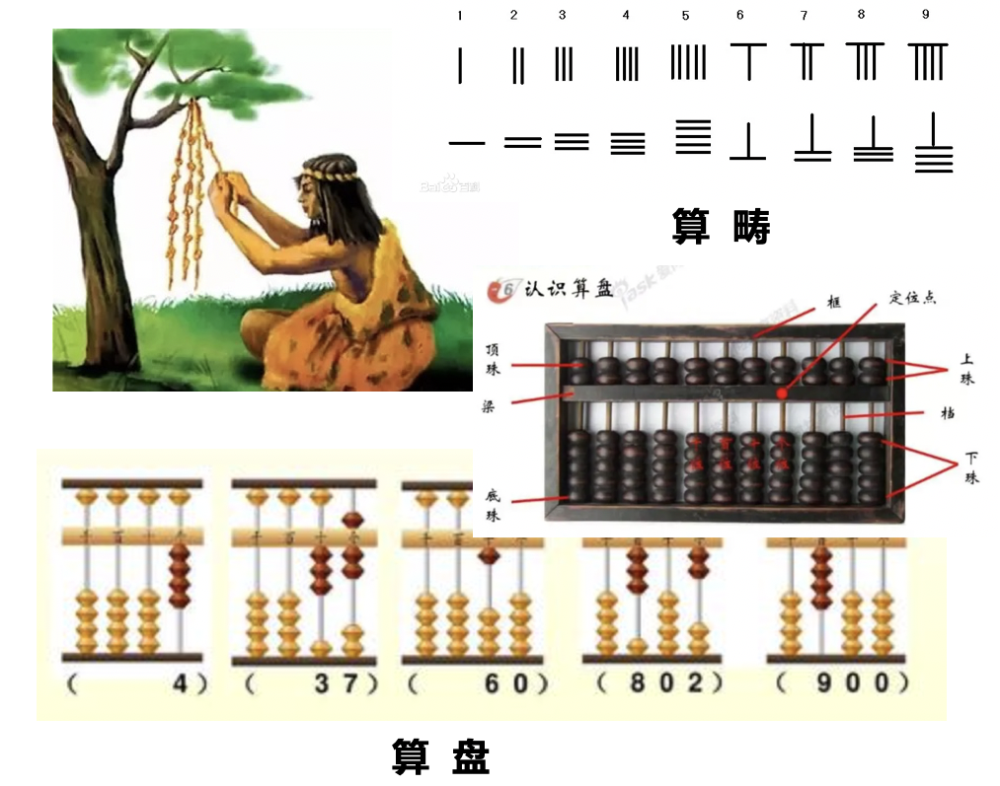

- 非进位计数制
  - 例如罗马数字：符号的值基本固定，由符号组合与减法规则表示数值
  - 不采用“满基数进一位”的规则

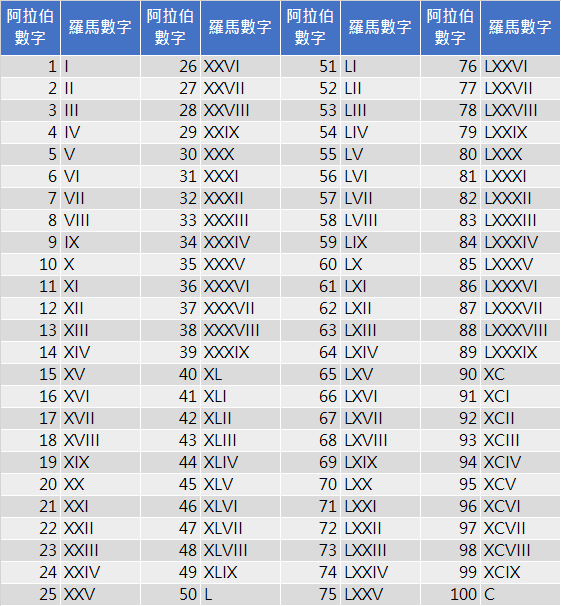

<!-- SLIDE -->


### 进位计数制

- 常用的进制
  - 十进制
  - 六十进制、十六进制
- 各种进制表达的数值
  - 十进制0/1/2/3/4/5/6/7/8/9
  - 二进制0/1
  - 八进制0/1/2/3/4/5/6/7
  - 十六进制0～9，A～F
- 注意：每个进制里的“10”
  - 最大个位数+1

<figure>

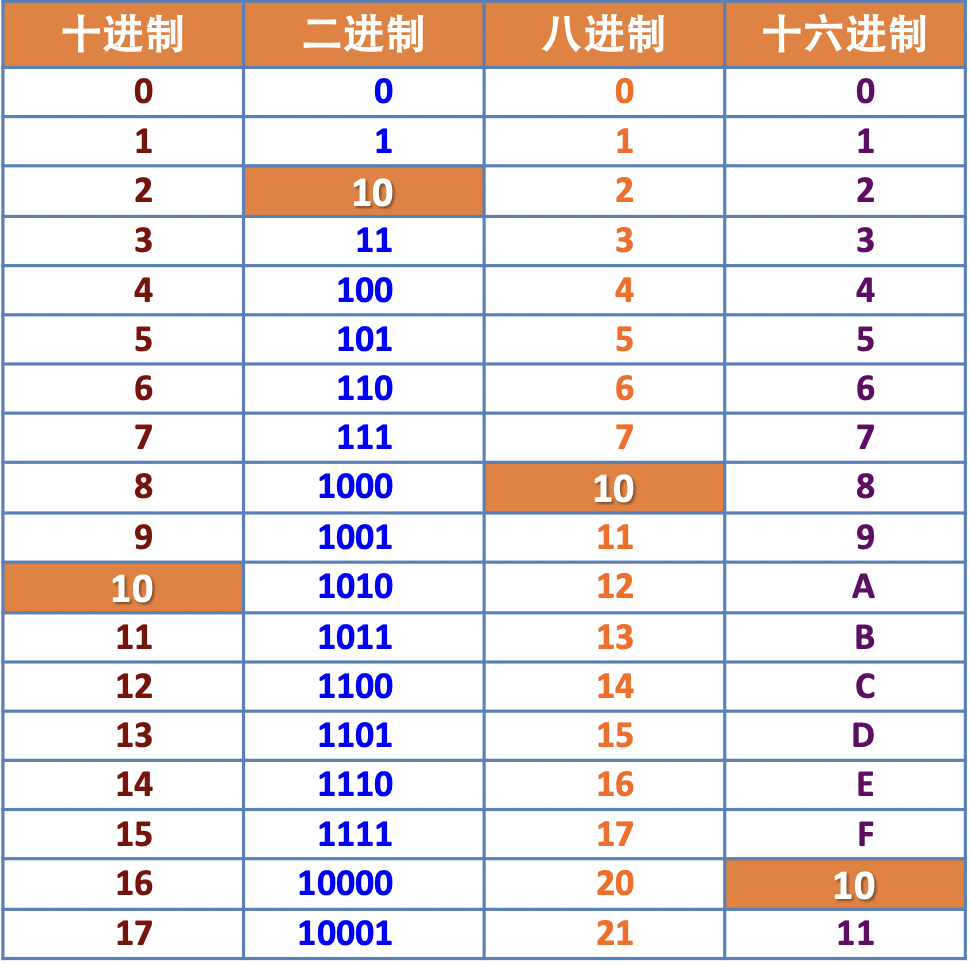

<figcaption>常用进制表</figcaption>

</figure>

<!-- SLIDE -->


### 不同数制有理数的转换

- 基本思想
  - 如果两个有理数相等，则这两个数的整数部分和小数部分一定分别相等
  - 在不同数制之间进行转换时，可以分别对整数部分和小数部分进行转换

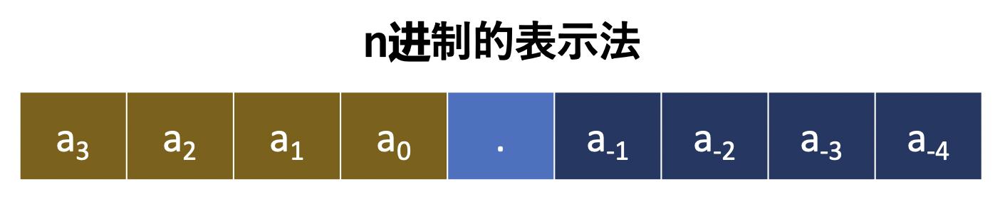

**位置权值公式**：
任意进制数 $A = \sum_{i=-j}^{k} d_i \times b^i$
其中 $b$ 为基数，$d_i$ 为第 $i$ 位数字。

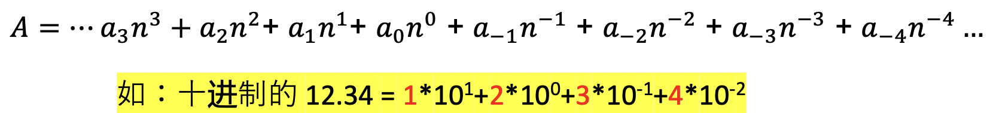

<!-- SLIDE -->


### 作为计算器的Python Shell

- 交互式的 **Python Shell**
    > 为了验证和试验后面有关进制转换的计算，
    > 并观察 Python 如何处理整数和进制，可以先使用交互式的Python Shell，不必编写完整程序。

    - 输入算术表达式或函数
    - 显示计算的结果
      - 不特意指定的话，输入输出均为十进制表示
    - 常见的运算符号
      - +，-，*，%，**
      - //（整数除法），/（小数除法）
    - 常见的函数
      - divmod(x,y), abs(x)
      - int(x)

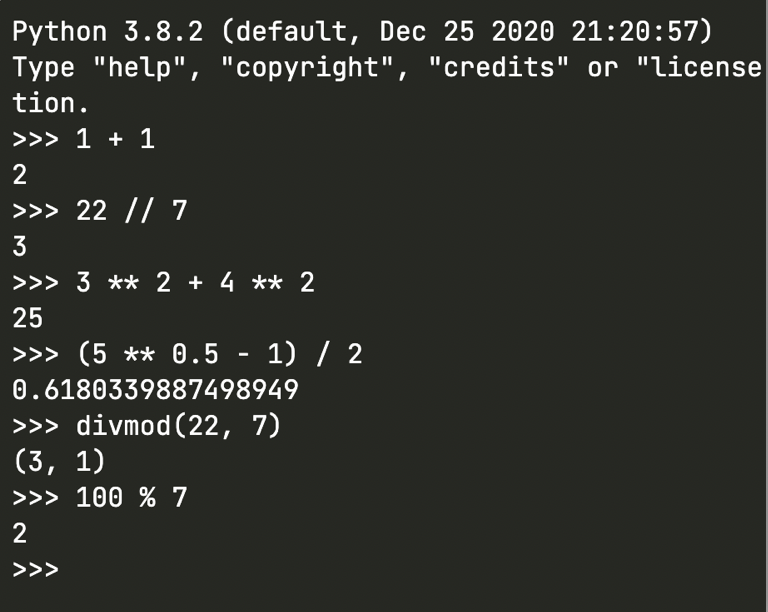

<!-- SLIDE -->

### 各进制表示的算法（十转二）

- 对于N进制而言
  - 整数部分：除以N取余数

<figure>

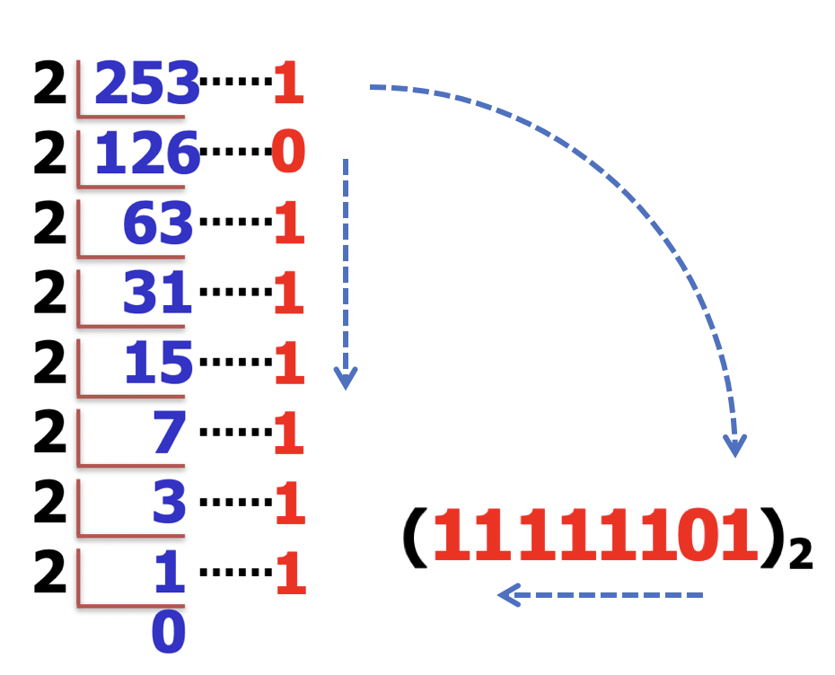

<figcaption>整数除基取余法</figcaption>

</figure>

用Python程序实现上面的过程：

```python
decimal_number = 253
base = 2
digits = []

while decimal_number > 0:
    quotient, remainder = divmod(decimal_number, base)
    digits.append(str(remainder))
    decimal_number = quotient

binary_number = ''.join(reversed(digits)) if digits else '0'
print(binary_number)
```

<!-- SLIDE -->


### 各进制表示的算法（小数十转二）

- 例如：二进制表示小数0.745
- 对于N进制小数
  - 小数部分：乘以N取整数
- 转换精度
  - 小数部分不为零时，重复次数越多，结果越精确
  - 不同进制表示同一个小数（有理数），有两种情况
  - 可能是有限小数
  - 可能是无限循环小数
- 存储误差
  - 计算机内部采用二进制保存数
  - 只能保存有限位数的bit，超出的会被截断
  - 因此产生误差

```
>>> 0.1+0.2
0.30000000000000004
```

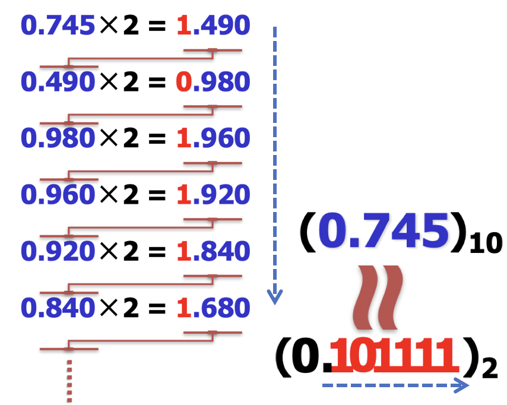

<!-- SLIDE -->

用Python程序实现上面的过程：

```python
fraction = 0.745
base = 2
binary_digits = []

# 最多计算 20 位二进制小数
for _ in range(20):
    if fraction == 0:
        break

    fraction *= base
    digit = int(fraction)
    binary_digits.append(str(digit))
    fraction -= digit

binary_fraction = '0.' + ''.join(binary_digits)
print(binary_fraction)
```

<!-- SLIDE -->


### 各进制数到十进制表示

- 把各进制数各个数位上的数按权值展开求和

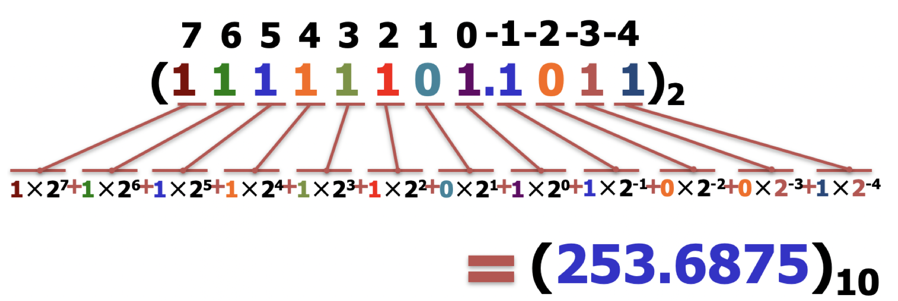

<!-- SLIDE -->


### 进制转换：Python内建方法

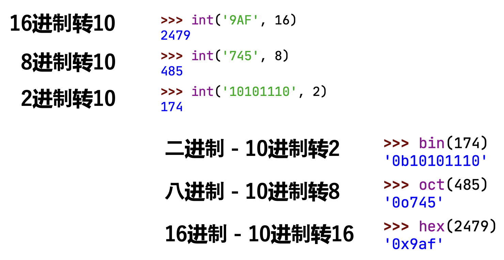

- `int(text, base)`：按指定进制将字符串转换为十进制整数
- `hex(number)`：将整数转换为以 `0x` 开头的十六进制字符串
- 字符串前缀
  - `0b` 表示二进制，`0o` 表示八进制
  - 使用 `int(text, 0)` 时，Python 会根据前缀自动判断进制

Python 没有通用的小数进制转换函数，因此小数需要使用前面的乘基取整法实现。

```python
int('g', 20)
hex(2479)
```

<!-- SLIDE -->


### 特殊的直接转换：二进制<->八进制

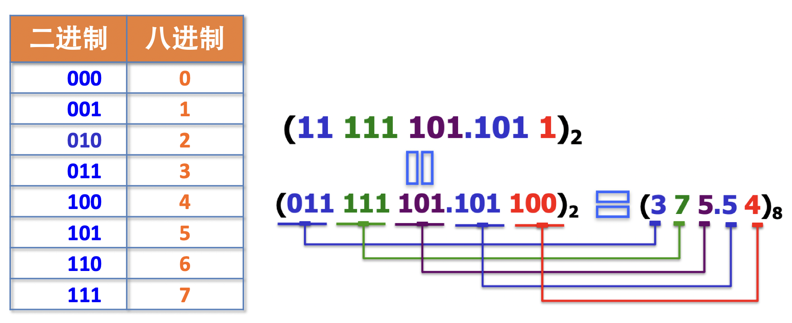

### 特殊的直接转换：二进制<->十六进制

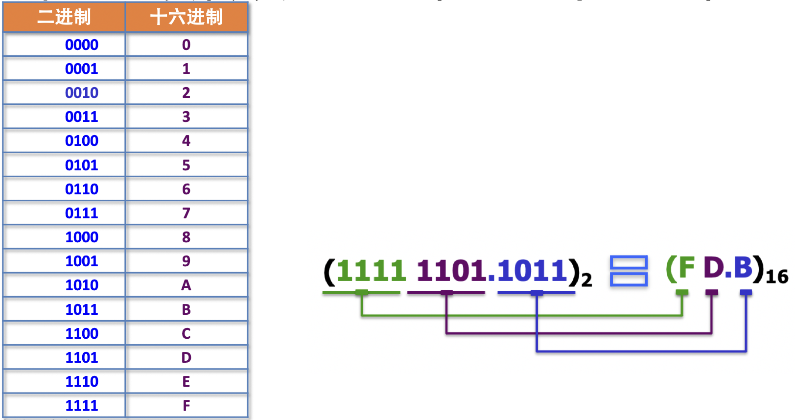

<!-- SLIDE -->

### 进制表示的实际应用

- 八进制：Linux 文件权限
  - `chmod 755` 中的三个数字分别对应用户、用户组和其他用户
  - 每个八进制数字对应三位二进制权限

```text
chmod 755 foo
7 = 111   5 = 101   5 = 101
-rwxr-xr-x  foo
```

- 十六进制：网页颜色
  - `#FF8800` 中的 `FF`、`88`、`00` 分别表示红、绿、蓝通道
  - 每个十六进制数字对应四位二进制，表示更加紧凑

```text
FF = 11111111   88 = 10001000   00 = 00000000
```

<!-- SLIDE -->

<details>
<summary>复习</summary>

- 如果 38 +1=40，这说明使用的是 <mark>9 </mark> 进制。(23y)
- 整数有不同进制的表示法，通常可以把整数放在括号()中，括号()后跟一下标表示其进制，以下关于整数的哪种表示是错误的?
	- A) $(110)_2$	
  - B) $(367)_8$	
  - C) <mark> $(9EH)_{16}$ </mark>	
  - D) $(221)_4$

- 数制转换运算
  - $ (2023)_{10}$ = (<mark>111 1110 0111</mark>)$_2$
  - $(5.375)_{10}$ = (<mark>101.011</mark>)$_2$
  - $(3D8A)_{16}$ = (<mark>11 1101 1000 1010</mark>)$_2$

> 可以按照课件上的办法一步一步计算；也有快办法：0.375 = 3/8 = (0.011)$_2$

</details>

<!-- SLIDE -->


## 二进制运算

### 算术运算

- 加减乘除的运算法则与十进制相同

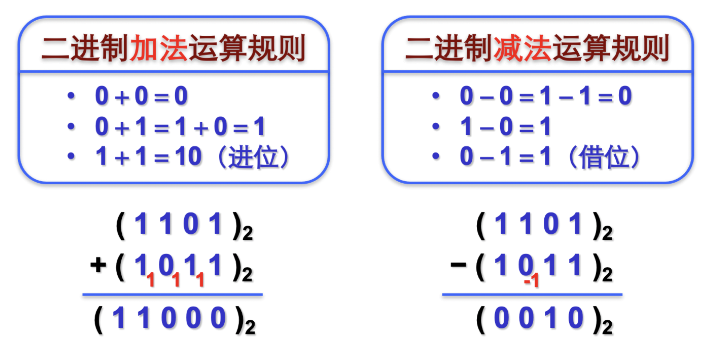

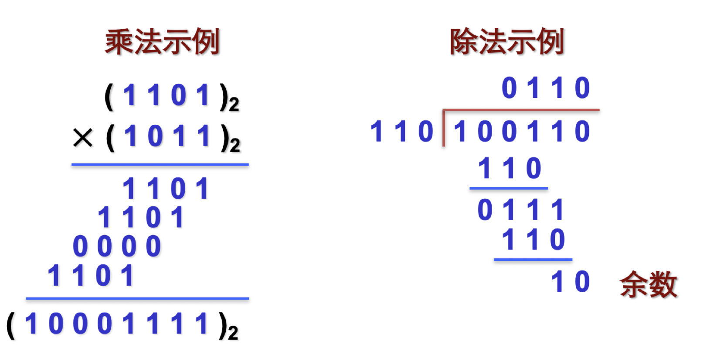

<!-- SLIDE -->


### 二进制逻辑运算

- 位运算
  - 逐位处理二进制数
  - 不产生进位
- 逻辑非：~
  - ~1 = 0;  ~0 = 1
- 逻辑或：|
  - 0 | 0 = 0;  0 | 1 = 1;  1 | 0 = 1;  1 | 1 = 1
- 逻辑与：&
  - 0 & 0 = 0;  0 & 1 = 0;  1 & 0 = 0;  1 & 1 = 1
- 逻辑异或：^
  - 0 ^ 0 = 0;  0 ^ 1 = 1;  1 ^ 0 = 1;  1 ^ 1 = 0

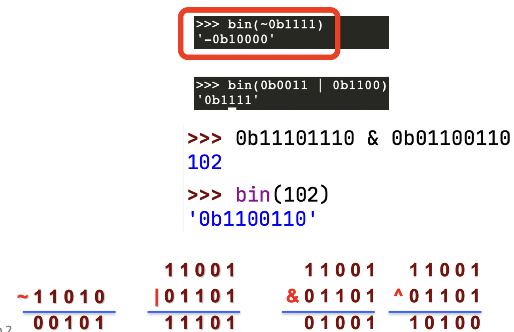

- Python中的表示与计算
  - 外部输入、输出默认使用十进制
  - 位运算时按整数的二进制位进行计算
  - Python 示例：

    ```python
    >>> 7 & 14
    6
    ```

    `0111 & 1110 = 0110`，结果为 `6`

<!-- SLIDE -->


#### 按位逻辑运算与逻辑值运算

* 逻辑`与`有两种表示，分别是这里的`&`和逻辑值运算`and`，两者并不通用
  - `1 and 2`与`1 & 2`不一样
* 逻辑`或`同理


<!-- SLIDE -->


### 二进制的移位运算

- 左移 n 位 `<< n`
  - 在最低位加 n 个 0（相当于乘以 $2^n$）
  - 如：`3 << 2 = 12`
  - python中的左移不存在**溢出**的问题
- 右移 n 位 `>> n`
  - 去掉 n 个最低位（相当于整除 $2^n$）
  - 如：`33 >> 3 = 4`
- Python 的 `int`
  - 没有固定字长，左移时自动扩展，通常不会溢出
  - 负数右移时高位补 `1`，保留符号位

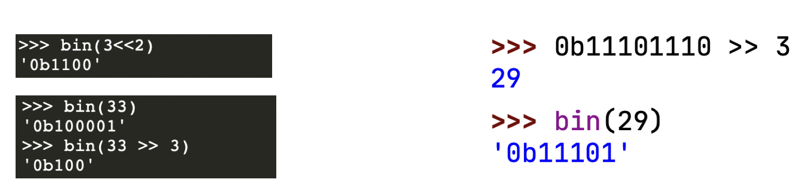

<!-- SLIDE -->


<details>
<summary>复习</summary>

- 二进制算术运算
  - 100101 * 101001 = (<mark>101 1110 1101</mark>)$_2$
  - 1110 0111 - 1001 1010 =  (<mark>100 1101</mark>)$_2$
- 二进制逻辑运算
  - 0110 0101 | (~0101 0011) = (<mark>1110 1101</mark>)$_2$

- 对于⼀个整型变量a ，如果希望只把a的低7位取反，正确的运算是______ 。
（^为⼆进制异或运算符）
  - A. `~a` B. `!a` <mark> C. `a^127` </mark> D. `a^255`

- 推广到低 `n` 位
  - 如果希望只把 `a` 的低 `n` 位取反，正确的运算是______。
  - <details>
    <summary>答案</summary>

    <mark>`a ^ ((1 << n) - 1)`</mark>

    </details>

</details>

<!-- SLIDE -->


### 浮点数的二进制表示

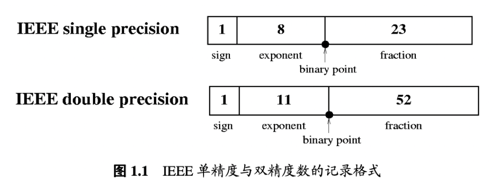

- IEEE 754 是应用最广泛的浮点数标准，采用类似科学计数法的表示方式
- 使用一个符号位、一个带偏置的指数域和一个有效数字小数域共同表示浮点数。

<!-- SLIDE -->


#### 示例：单精度表示 13.25

```text
13.25 = 1101.01₂ = 1.10101₂ × 2³
```

| 字段 | 内容 | 说明 |
| --- | --- | --- |
| 符号位 | `0` | 正数 |
| 指数域 | `10000010` | `3 + 127 = 130` |
| 小数域 | `10101000000000000000000` | 去掉最高位隐含的 `1` |

组合后的 32 位表示为：

```text
0 10000010 10101000000000000000000
```

<!-- SLIDE -->


#### 浮点数的范围与精度

- 浮点数的表示范围有限，可能发生溢出；有效位数有限，也可能丢失精度
- Python 中的浮点数默认采用 IEEE 754 双精度（`float64`）
- 表格中的“字节数”采用前文容量单位的定义，详见“计算机中的二进制”一节

| 特性          | 单精度（float32） | 双精度（float64） |
| ----------- | ------------ | ------------ |
| 字节数         | 4 字节         | 8 字节         |
| 十进制有效数字 | 约 7 位有效数字    | 约 15～16 位有效数字 |
| 范围          | ±3.4×10³⁸    | ±1.8×10³⁰⁸   |
| 存储结构        | 1+8+23       | 1+11+52      |
| Python 默认类型 | 否            | 是            |

<!-- 2500011730 贡献加分 0.5 -->


<!-- SLIDE -->


#### **3.4×10³⁸ 的来历**

最大的正单精度有限浮点数这样构造：

- 符号位为 `0`，表示正数
- 指数域为 `11111110`，避开表示无穷大和 NaN 的全 `1` 状态
- 小数域为 23 个 `1`

```text
0 11111110 11111111111111111111111
```

实际指数为 `254 - 127 = 127`，所以：

```text
(2 - 2^-23) × 2^127 ≈ 3.4028234663852886×10^38
```

这里的完整十进制展开只是边界值的数值写法，并不表示单精度具有这么多位的精度；`float32` 通常只有约 7 位十进制有效数字。

<!-- SLIDE -->


### 整数的二进制表示

整数有下面三种二进制编码方式，区别在于负数是如何编码的。

- 以单字节(8bits)为例
- 原码
  - 通常意义上的二进制
  - 需要1bit表示正负，7b表示值
    - 5 = 0000 0101
    - -5 = 1000 0101
  - 求相反数：改变符号位
- 反码
  - 正数与原码相同
  - 负数：把它**绝对值**的二进制逐位取反（0 变 1，1 变 0）
      - 5 = 0000 0101
      - 逐位取反 → 1111 1010，即 -5
  - 求相反数：逐位取反
- 补码
  - 正数与原码相同
  - 负数：先写出**绝对值**的二进制，逐位取反，再在**最低位加 1**
      - 5 = 0000 0101
      - 逐位取反 → 1111 1010
      - 最低位加 1 → 1111 1011，即 -5
  - 求相反数：对这个数的补码再做一次“取反加一”
      - -5 的补码 1111 1011，取反 → 0000 0100，加 1 → 0000 0101 = 5
      - 正负两个方向用的是同一套操作

> “取反加一”中，取反是把八位逐位翻转，加一是在最低位加 1，有进位照常向左进。


<!-- SLIDE -->

#### 加减运算：原码计算法

- 减法转为加法
  - `A - B = A + (-B)`
- A+B
- A、B同号
  - 绝对值相加
  - 结果使用相同的符号

- A、B异号
  - 绝对值相减
  - 结果使用绝对值较大数的符号

```text
  00001010                 00001101
+ 00001111               - 00001011
----------               ----------
  00011001                 00000010

 10+15=25                 13-11=2
```


<!-- SLIDE -->

#### 加减运算：补码计算法

- 减法转为加法
  - `A - B = A + (-B)`
- A+B
  - 直接相加!
  - 无需减法逻辑
  - 自动获得正确的符号

- 计算机内部普遍采用补码表示整数，简化了算术电路
  - 此外，补码中 0 只有一种表示，乘法的低位、按位运算和左移也能与无符号数共用同一套电路

```text
  00001010                 00001101
+ 00001111               + 11110101
----------               ----------
  00011001                 00000010

 10+15=25             13-11=13+(-11)=2
```

> 右式按 8 位相加实际得到 `1 00000010`，超出 8 位的最高位进位 `1` 舍弃，结果为 `00000010`。

<!-- SLIDE -->


## 计算机中的二进制

### 二进制信息存储容量的量化单位

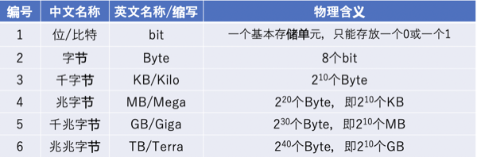

- 基本单位
  - 位（bit）：一个二进制位，只能存放 0 或 1
  - 字节（Byte）：`1 Byte = 8 bit`
- 逐级放大
  - 相邻单位相差 $2^{10} = 1024$ 倍
  - KB → MB → GB → TB，见上表
- 更大的量化单位
  - PB（Petabyte）、EB（Exabyte）、ZB（Zettabyte）
  - YB（Yottabyte）、RB（Ronnabyte）、QB（Quettabyte）
- 书写习惯
  - 大写 **B** 表示 Byte，小写 **b** 表示 bit
  - 例：`100 Mb/s` 以比特计，`100 MB` 以字节计

<!-- SLIDE -->


#### 二进制的千、兆、吉

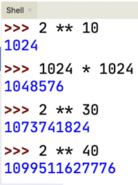

- 二进制前缀
  - 以 $2^{10} = 1024$ 为进位
  - K = $2^{10}$，M = $2^{20}$，G = $2^{30}$，T = $2^{40}$
- 十进制前缀
  - 以 $10^3 = 1000$ 为进位
  - 千 = $10^3$，兆 = $10^6$，吉 = $10^9$
- 两者略有不同
  - $1024 \approx 1000$，不严格时可以忽略差别
  - 级数越高差别越大：$2^{30} \approx 1.074 \times 10^9$
  - 需要严格区分时，二进制前缀写作 KiB、MiB、GiB

<!-- SLIDE -->


#### 十进制前缀的使用场合

硬盘、网络速率等场合使用的是十进制前缀。

- 硬盘容量
  - 厂商标称：1 TB = $10^{12}$ Byte
  - 系统按 $2^{30}$ 换算，显示约 931 GiB
- 通信速率
  - Mb/s（Megabits/second）、Gb/s（Gigabits/second）
  - 同样使用十进制前缀，最小单位是 bit

| 领域          |  量词前缀  |  最小单位   |
| ---           |  ---      |   ---   |
| 计算机（文件）| 二进制     | Byte |
| 存储（硬盘）    | 十进制  | Byte |
| 通信（带宽）  | 十进制    | bit |


<!-- SLIDE -->


<details>
<summary>复习</summary>

你家装了联通的千兆宽带，08 年北京奥运会开幕式的高清录像文件有 4 GB，从网上下载下来最少要多久？

- 文件大小：<mark>4096 MB</mark>
  - 使用二进制前缀
  - 4 GB = 4 × 1024 MB
- 网络速度：<mark>125 MB/s</mark>
  - 使用十进制前缀
  - 1000 Mb/s ÷ 8 = 125 MB/s
- 下载时间：约 <mark>33 秒</mark>
  - 4096 ÷ 125 ≈ 33

> 不严格区分两种前缀时，约 33 秒即可。
> 严格计算：$4 \times 2^{30}$ Byte ÷ $(125 \times 10^6)$ Byte/s ≈ 34.4 秒。
> 两者相差约 5%，正是上一页所说"级数越高差别越大"的体现。
</details>

<!-- SLIDE -->


### 字与字长：CPU 一次处理多少位

- 字（word）
  - CPU 一次能处理的、长度固定的数据单位
  - 长度随 CPU 而定：16 位 CPU 的字是 16 bit，64 位 CPU 的字是 64 bit
  - 一个字通常包含多个字节（Byte）
- 字长
  - 一个字包含的二进制位数
  - 通常等于 CPU 通用寄存器的位数
  - 是衡量计算机性能的重要指标
- 字长的演进（Intel）
  - 早期：4 位 4004（1971）→ 8 位 8008（1972）→ 16 位 8086/8088（1978/1979）
  - 32 位时代：80386（1985），即 IA-32
  - 64 位时代：x86-64（AMD 于 2003 年推出 AMD64，Intel 称为 Intel 64）
- 现代计算机
  - PC 和服务器的字长多为 64 位，32 位已逐渐淘汰
  - 手机中的 ARM 芯片也已普遍采用 64 位

<!-- SLIDE -->

#### x86 的数据长度单位

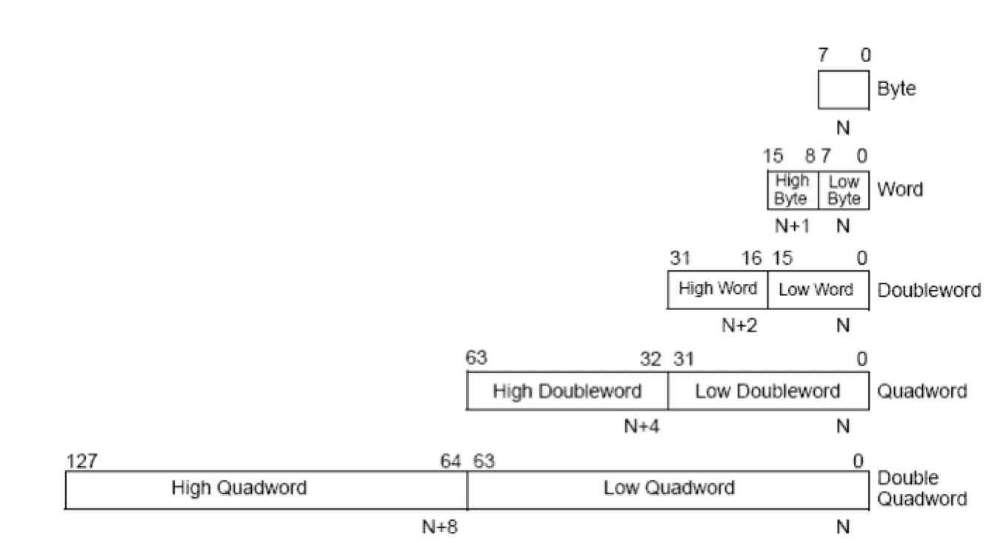

- 此"字"非彼"字"
  - 这里的 Word 是 x86 中的数据类型名称，固定为 16 bit
  - 上一页的"字"随 CPU 而变，64 位 CPU 的字是 64 bit
- 名称来自 16 位时代
  - 字节 Byte = 8 bit
  - Word = 16 bit：8086 的字长是 16 位，名称由此而来，此后不再改变
- 以 Word 为基准成倍增加
  - 双字 Doubleword = 32 bit
  - 四倍长字 Quadword = 64 bit
  - 双四倍长字 Double Quadword = 128 bit
- 多字节数据的存放
  - 图中 N、N+1、N+2… 为内存地址
  - x86 把低位字节放在低地址，称为小端序（little-endian）


<!-- SLIDE -->

#### 操作系统与 CPU 字长

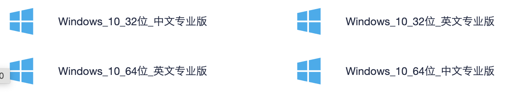

- 操作系统需与 CPU 字长适配
  - 同一系统常分 32 位和 64 位两个版本，如上图
  - 64 位 CPU 可以运行 32 位或 64 位系统
  - 32 位 CPU 只能运行 32 位系统
- 字长影响可用内存
  - 内存地址也用一个字来表示
  - 32 位地址最多区分 $2^{32}$ 个字节，即 4 GB
  - 因此 32 位系统通常最多只能使用约 4 GB 内存
- 32 位逐渐退出
  - 64 位系统可以兼容运行大多数 32 位程序
  - Windows 11 起只提供 64 位版本


<!-- SLIDE -->


## 数字化原理

### 数字化：信息的输入与输出

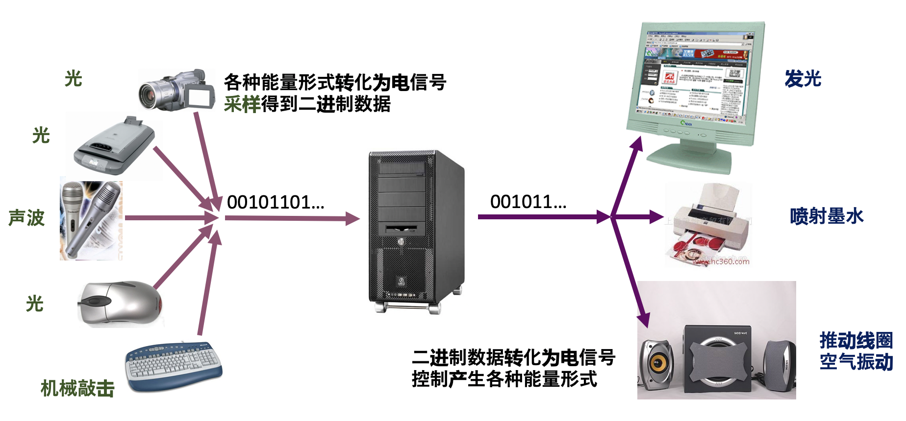

- 输入：物理量 → 二进制
  - 光、声波、机械敲击等能量形式先转换为电信号
  - 再经采样得到二进制数据，这一过程称为 **数字化**
  - 如摄像机、扫描仪、麦克风、鼠标、键盘
- 处理：内部只有二进制
  - 所有信息都以 0 和 1 的形式存储、处理和传输
  - 本章前面讨论的数制、运算和数的表示都在这一层
- 输出：二进制 → 物理量
  - 二进制数据先转换为电信号
  - 再控制设备产生各种能量形式
  - 如显示器发光、打印机喷射墨水、音箱推动线圈使空气振动

**数字化**是计算机存储、处理和传输一切信息的前提。文字、声音、图像等不同类型的信息，数字化的方法各不相同，下面分别讨论。

<!-- SLIDE -->

### 各种数据类型的编码


把信息从一种形式（通常是自然的、模拟的或人类能理解的形式）转换成**数字形式**（0和1的二进制代码）的过程。

#### 编码：从身份证说起

- 数组表示
  - A[start:end]代表start~end-1位的数组，从0计数。
  - 起始位置:start，结束位置：end-1
  - 身份证从左至右依次为：六位数字地址码，八位数字出生日期码，三位数字顺序码和一位数字校验码。

  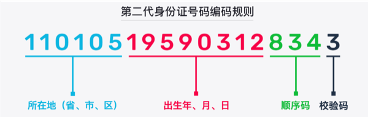

<!-- SLIDE -->

<details>
<summary>复习</summary>

- 一个地区的车牌号共包含 5位，第一位是大写字母(A~Z)，后 4 位是十进制数(0~9)，最多可以有<mark>$26\times 10^4$</mark> 种不同的车牌。(23y) 

</details>

<!-- SLIDE -->

#### 数值表示

把数编码成二进制
- 原码/反码/补码

#### 指令编码

不管是什么语言编写的程序，计算机/CPU看到的都只是指令的序列
- 将计算机内部所能进行的各种基本操作用二进制数表示出来，以便于计算机的识别于运行。如：
  - 跳转JMP 0xEA 11101010
  - 逻辑或计算OR 0x0C 00001100
  - 等等

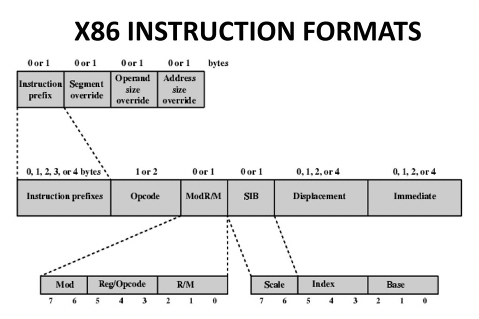

<!-- SLIDE -->

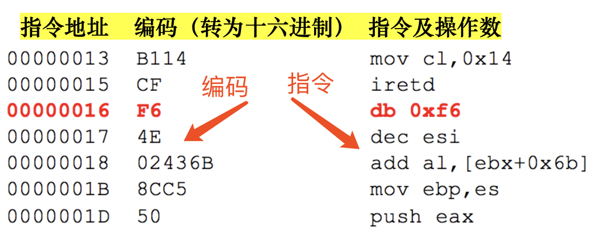

- x86只是指令集中的一种（属于CISC：指令多、长度不固定、功能强大）

<!-- SLIDE -->

<details>
<summary>复习</summary>

一台 16 位计算机有 16 个数据寄存器（R0~R15）、1024 个字的存储空间以及 16 种不同的指令（如 add、subtract 等）。
`add M R2` 这条指令最少需要占 ______ 位空间？
（M 是存储空间的某个地址，内存以 1 个字节为管理单元）

> 答案：<mark>19</mark> 位
> - 操作码：4 位
>   - 16 种指令，$2^4 = 16$
> - 寄存器：4 位
>   - 16 个寄存器，$2^4 = 16$
> - 内存地址：11 位
>   - 16 位计算机的 1 个字 = 2 个字节
>   - 1024 个字共 2048 个字节，$2^{11} = 2048$
> - 合计：4+4+11 = 19 位
>
> 实际设计中还要考虑对齐（Alignment）：指令长度通常取字节或字的整数倍（如 24 位或 32 位），这样能简化 CPU 取指令的操作，减少访存次数，提高效率。

</details>


<!-- SLIDE -->


#### 文字编码

##### 英文字符编码ASCII码

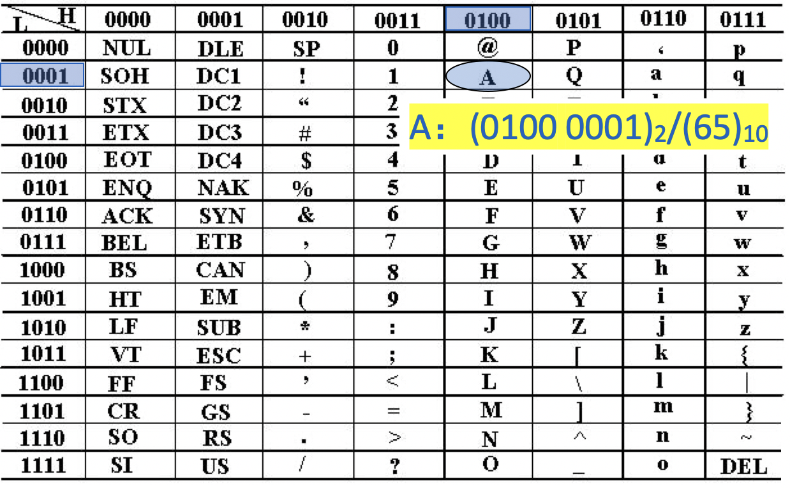

- ASCII码
  - 美国信息交换标准码（American Standard Code for Information Interchange）
  - 国际上使用最广泛的字符编码
- ASCII码的编码规则
  - 每个字符用7位二进制数( $d_6d_5d_4d_3d_2d_1d_0$ )来表示；
  - 可表示128个字符（7位二进制共有128种状态，$2^7$ = 128）
- ASCII码在计算机中的存储
  - 在计算机中，每个字符的ASCII码用一个字节存
  - 字节的最高位d7为校验位（可以用来进行奇偶校验），实际上用0填充；字节的后7位为实际编码值


<!-- SLIDE -->


##### ASCII 码的解码

解码是把编码后的数字信息还原为人能够理解的字符或内容。

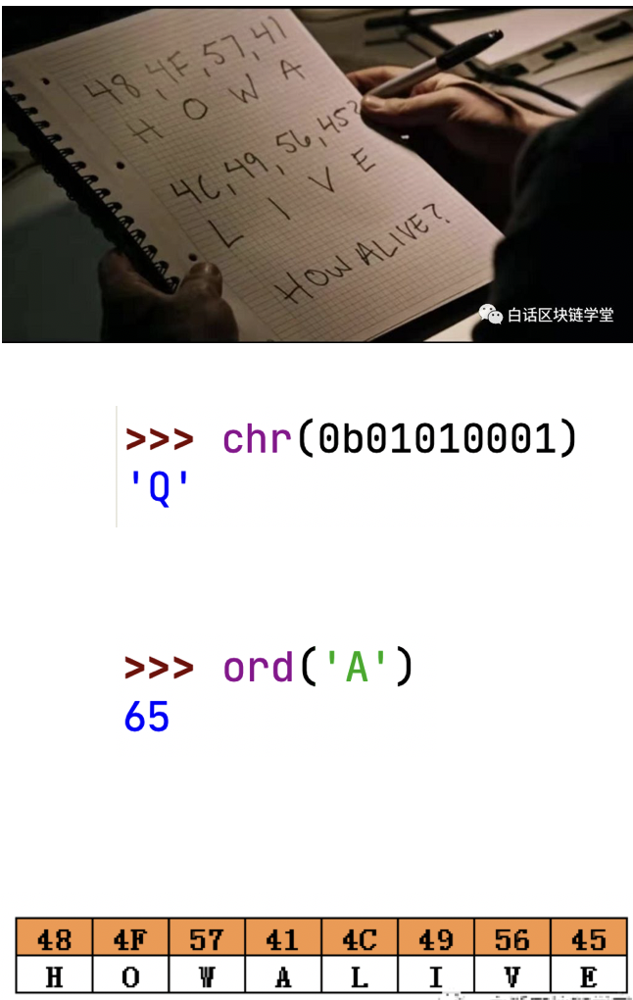

<!-- SLIDE -->

<details>
<summary>复习</summary>

- 二进制信息查看

 (1) 小北学习了信息编码原理后，有一天从网上看到可以通过某些编辑软件来查看文件的二进制编码信息。网页上说，在软件中安装十六进制编辑插件，打开文件后选择十六进制方式查看，可以看到文件中具体存放的二进制信息。于是小北立刻进行了尝试，他新建了一个空的文本文件，在其中输入了一段文本: "Welcome to Peking University!"，然后按上述模式进行观看，屏幕上显示如下：

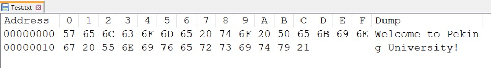

(注:字符W的ASCII码的十六进制表示为57，字符e的ASCII码的十六进制表示为65，以此类推)

 小北发现了其中的规律，感觉像是打开了一扇通往新世界的大门。他兴奋地在文件中输入了一条新的消息，并截图发给他的室友(文本已屏蔽)。请帮小北的室友判断一下，小北输入的是什么内容?

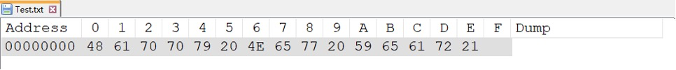

文本内容：<mark>Happy New Year!</mark> (2分)

<!-- SLIDE -->


（2）小北的室友也决定试一把，他在文件中输入"Hello World!"，屏幕上显示的数据会是什么样？

请把表格中的信息补全。（2分）

| Address  | 0  | 1  | 2  | 3  | 4  | 5  | 6  | 7  | 8  | 9  | A  | B  |
| -------- | -- | -- | -- | -- | -- | -- | -- | -- | -- | -- | -- | -- |
| 00000000 | 48 | 65 | 6C | 6C | 6F | 20 | 57 | 6F | <mark>72</mark> | <mark>6C</mark> | <mark>64</mark> | <mark>21</mark> |


<!-- SLIDE -->

给出表达式

1. 已知变量c存储了一个字母的ASCII码，请写一个表达式判断其值是否为大写英文字母(如果是，得到True；否则，得到False)
      ```python
      65 <= c <= 90
      ord('A') <= c <= ord('Z')
      ```

<!-- SLIDE -->

2. 已知i是一个整数（取值范围：0 到4294967295）表示一个北大学生的学号。已知小明所在年级的同专业同学的学号都是2310305XXX这种形式，而与他同专业的在校高年级学生的学号只能是2010305XXX，2110305XXX，2210305XXX这种形式。请写一个表达式判断具有学号i的学生是否是小明的同专业同学或师兄师姐(如果是，得到True；否则，得到False)
      ```python
      (20 <= (i // 100000000) <= 23) and ((i // 1000) % 100000 == 10305)
      ```
 > 题意为：最高两位在20~23的范围，中间五位为10305，末尾三位不限。

</details>

<!-- SLIDE -->


##### 汉字编码 – 国标

- 常用汉字数量：3000～5000个
  - 无法用一个字节来编码
- 国标码GB2312-80《信息交换用汉字编码字符集 基本集》
  - 共收集了6763个字符
  - 用两个字节来编码一个汉字；每个字节的最高位为0
  - 一种定长编码方式
- 国标码在计算机中的存储：汉字内码
  - 把国标码两个字节的最高位变为1（避免和ASCII码发生冲突）
  - 同一段文字中，可以既有国标码字符，又有ASCII码字符

目前网页和新开发的程序大多已改用 UTF-8；GB2312 的扩展 GBK、GB18030 在中文 Windows 等环境中仍在使用，其中 GB18030 是国家强制标准。


<!-- SLIDE -->


##### Unicode字符集

- Unicode是为了解决传统的字符编码方案的局限而产生的
  - 它为每种语言中的每个字符（含😊）设定了统一并且唯一的二进制编码
  - 以满足跨语言、跨平台进行文本转换、处理的要求
- Unicode 为世界上所有字符都分配了一个唯一的数字编号，这个编号范围从 0x000000 到 0x10FFFF (十六进制)，有 110 多万

<!-- SLIDE -->

- 每个字符都有一个唯一的 Unicode 编号，这个编号一般写成 16 进制，在前面加上 U+
  - 例如：“马”的 Unicode 是U+9A6C。
- Unicode字符百科：https://unicode-table.com/cn/


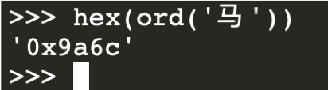


<!-- SLIDE -->

##### Unicode 编码的存储与再编码

Unicode 只为每个字符分配一个统一编号，在计算机中如何存储编号仍然是一个问题。
因此设计了UTF-8、UTF-16 或 UTF-32 等不同方案，把编号转换为字节序列，这也叫“编码“。

- 为什么不直接保存编号
  - 最大编号 0x10FFFF 需要 21 bits，但各字符的编号长短不一，需要约定字符的边界
  - 统一按 4 个字节存放（即 UTF-32）最简单，但英文文本会膨胀为原来的 4 倍，也不兼容 ASCII
  - 多字节数据还有字节顺序（大端、小端）的问题
- 不同方案的取舍
  - UTF-8：变长，兼容 ASCII，英文最省空间，网页和 Linux 中最常用
  - UTF-32：定长，按下标取字符方便，但最占空间

- Unicode编号有多种编码存储方案：UTF-8，UTF-16，UTF-32
  - 涉及长度、多字节位置（大小端）等不同安排，具体方案见参考资料
    - https://blog.csdn.net/zhusongziye/article/details/84261211
  - 每个字符：UTF-32（4字节，定长），UTF-8（1~4个字节），UTF-16（2或4个字节）

   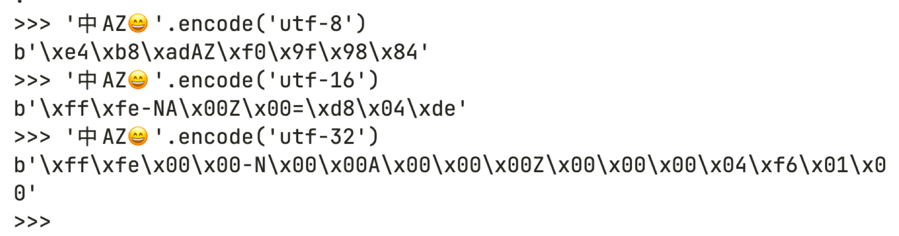

  - UTF-16/UTF-32对字符进行编码，在字符本身之外还有一些额外开销，比如上面的`b'\xff\xfe'`，表示BOM(Byte Order Mark)

<!-- SLIDE -->

<details>
<summary>复习</summary>

- 以下哪个编码字符集，为世界上绝大部分语言设定了统一并且唯一的二进制编码，以满足跨语言、跨平台的文本交换需求?目前该编码字符集中已经收录了超过十万个不同字符。(23y)
	- A) ASCII	
  - B) <mark>Unicode</mark>	
  - C)GBK 2312	
  - D)BIG5


<!-- SLIDE -->

- ASCII码是一种字符编码标准，它使用_____ 个字节编码单个字符，一共编码了128个不同的字符。

- 已知大写字母 `X` 的 ASCII 编码的16进制表示为$(58)_{16}$ ，则字母 `N` 的 ASCII 编码是(___)$_{16}$ 。
  > <mark>1</mark>个字节；<mark>(4E)</mark>$_{16}$，X在N后面第10个字符，$(58)_{16} - 10 = (4E)_{16}$

</details>


<!-- SLIDE -->


#### 声音编码

##### 声波的离散采样与编码

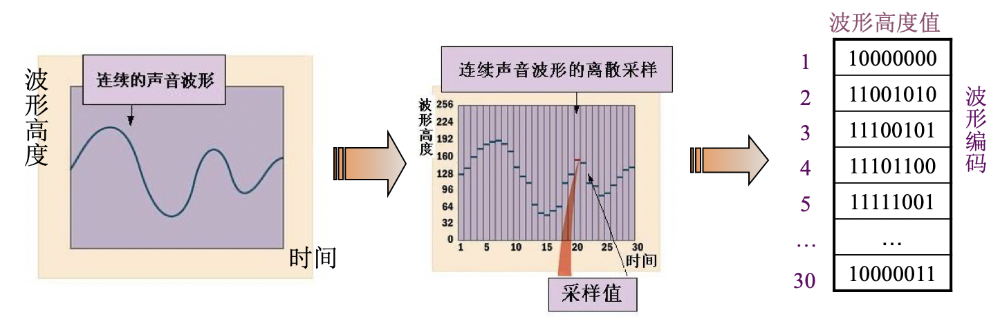

- 两个维度分别离散化
  - 时间：按均匀的时间间隔取点，称为**采样**
  - 振幅：把每个采样点的波形高度近似为有限个等级，称为**量化**
- 用二进制整数编码
  - 每个量化后的高度值记为若干位二进制整数
  - 按时间顺序记录这些整数，就得到声音的数字表示
- 波形编码
  - 这种记录声音的方式称为声音的**波形编码**
  - 采样越密、编码位数越多，越接近原始声波

<!-- SLIDE -->


##### 发声输出

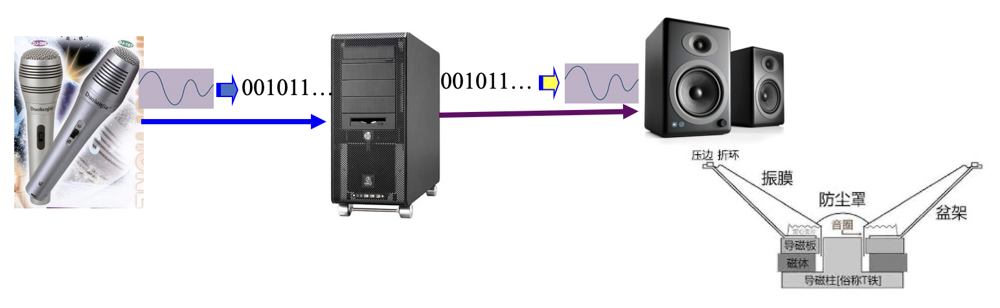

- 录音：声波 → 二进制
  - 麦克风把声波转换为电信号
  - 再经采样、量化得到二进制数据
- 放音：二进制 → 声波
  - 声卡把波形编码数据还原为电信号（数模转换）
  - 电信号驱动音箱中的音圈，带动振膜振动空气，发出声音
- 记录与发声缺一不可
  - 仅仅记录声音的波形，还听不到声音
  - 需要音箱、扬声器等发声设备把数据还原为声波


<!-- SLIDE -->

##### 声音的质量与存储空间

- 质量取决于采样和量化
  - 采样点的时间间隔越小，越接近原始声波
  - 波形高度的编码位数越多，记录的高度越精确
- 采样频率
  - 单位时间内对声波的采样次数，单位为 Hz（赫兹）
  - 每秒采样 500 次即为 500 Hz
  - 音乐 CD 约为 44 kHz，更高可达 48 kHz、96 kHz
  - 这里的 kHz 是十进制前缀：1 kHz = 1000 Hz
- 量化位数与声道
  - 每个声道常用 16 bit（2 字节）记录波形高度，更高可达 24 bit
  - 为了获得较好的声音效果，通常采用双声道（立体声）
- 质量与空间的权衡
  - 采样频率越高、位数越多、声道越多，声音质量越好
  - 占用的存储空间也越大


<!-- SLIDE -->

##### 存储空间的计算

**例**：一首 4 分钟长的歌曲（采样频率 44 kHz，立体声，每个采样 16 bit），需要占用多少存储空间？

- 计算公式
  - 总 bit 数 = 时间（秒）× 采样频率 × 每个采样的位数 × 声道数
- 代入计算
  - $240 \times 44000 \times 16 \times 2 \div 1024 = 330{,}000$ Kb
  - $330{,}000 \div 8 = 41{,}250$ KB ≈ 40 MB

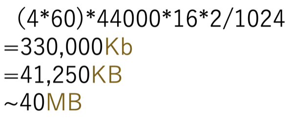


<!-- SLIDE -->

##### 声音的压缩存储

- 波形编码占用空间大
  - 一首 4 分钟的歌曲约 40 MB
  - 存储 1 小时的音乐需要 600 多 MB
- MP3 压缩
  - 对声音的波形编码进行压缩处理
  - 一首 4 分钟的歌曲只需约 4 MB（码率 128 kbps），约为原来的 1/10
  - 16 GB 的 U 盘可以存放约 4000 首歌曲
- 查看音频的编码参数
  - 用 Python 的 `wave` 模块读取 WAV 文件的采样频率、声道数、采样位数等
  - 用 MediaInfo 可以查看多媒体文件的详细编码信息：https://mediaarea.net/zh-CN/MediaInfo

```python
>>> import wave
>>> wave.open('yyq.wav').getparams()
_wave_params(nchannels=2, sampwidth=2, framerate=44100, nframes=8630831, comptype='NONE', compname='not compressed')
```

其中 `sampwidth` 以字节为单位，`sampwidth=2` 即每个采样 16 bit。


<!-- SLIDE -->

<details>
<summary>复习</summary>

当音乐被数字化存储到计算机中时，声音信号必须经过：(23y)

- A) 采样
- B) 离散化
- C) 编码
- D) <mark>以上 A、B、C 都要</mark>

> 采样在时间上取点，离散化（量化）把波形高度近似为有限个等级，编码再用二进制数表示，三步缺一不可。

</details>


<!-- SLIDE -->


#### 颜色编码

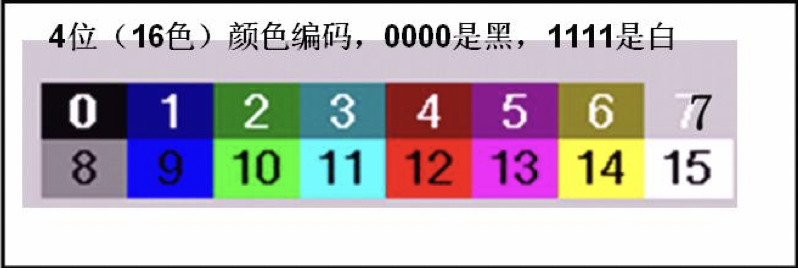

- 颜色也是连续现象
  - 光谱连续变化，颜色无法穷举
  - 需要离散化：把相近的颜色归为同一种，用一个二进制数表示
- 位数决定颜色数
  - 单色：1 位，2 种颜色
  - 灰度：8 位，256 级灰度
  - 彩色：4 位 16 色（如上图，0000 是黑，1111 是白），8 位 256 色
  - 高彩色：16 位，65536 色；真彩色：24 位，约 1677 万色
  - 32 位：24 位颜色 + 8 位透明度
- 显示效果受硬件限制
  - 实际能呈现的颜色还取决于显示器等设备
  - 编码的颜色数再多，显示器表现不出来也看不到

<!-- SLIDE -->


##### 图像颜色模型：RGB 与 HSV

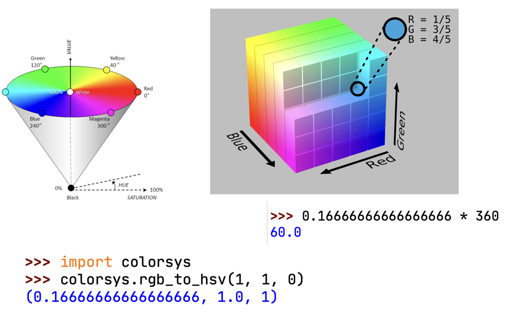

- RGB 三原色模型
  - 用红（R）、绿（G）、蓝（B）三种颜色的强度混合出各种颜色
  - 每种颜色用 1 个字节表示，取值 0～255
  - 共 $256^3 = 16{,}777{,}216$ 种颜色，即 24 位真彩色
- RGBA 模型
  - 在 RGB 基础上增加 1 个字节表示透明度（Alpha）
  - 每个像素共 4 个字节（32 位）
- HSV 模型
  - 色相（Hue）：颜色的种类，用 0°～360° 表示，如红 0°、黄 60°、绿 120°、蓝 240°
  - 饱和度（Saturation）：颜色的鲜艳程度
  - 明度（Value）：颜色的明亮程度
  - 更接近人对颜色的直观感受，常用于调色

> 打个比方：RGB 像**直角坐标**，用三个轴上的分量确定一种颜色；HSV 像**柱坐标**，绕着从黑到白的灰色轴转多少度是色相，离轴多远是饱和度，沿轴升多高是明度。同一种颜色，换一套“坐标”来描述而已。（严格地说，HSV 更接近以黑色为原点的球坐标，这里只作直观理解。）

- Python 中的转换
  - `colorsys.rgb_to_hsv()` 把 RGB 转为 HSV，取值都在 0～1 之间
  - 色相乘以 360 得到角度，如黄色为 60°（见图中代码）

<!-- SLIDE -->


#### 图像编码

##### 像素和图像


- 像素（Pixel）
  - 组成图像的基本单元，是规则排列的小方格
  - 每个像素有自己的位置和颜色值，如上图中的一个个方格
- 图像（Image）
  - 由像素按行、列排列成的矩形网格
  - 在计算机中可以看作一个二维的数值矩阵
- 图像的属性
  - 分辨率：横向、纵向的像素个数，如 1920×1080
  - 像素密度：单位长度内的像素个数，如 PPI（每英寸像素数）
  - 颜色模型：每个像素的颜色如何编码，如灰度、RGB

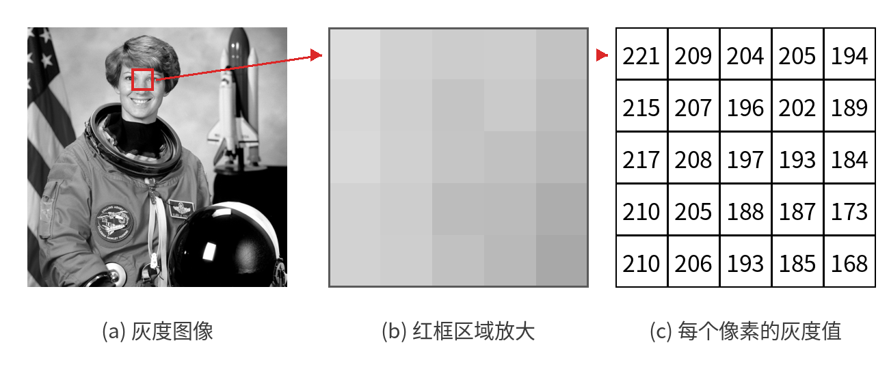

- 灰度图像的例子
  - 把人像面部的一小块（5×5 像素）放大，每个方格就是一个像素
  - 每个像素用 0～255 的整数表示灰度，数值越大越亮

<!-- SLIDE -->


##### Python 中读取图像


- 安装 Pillow 库
  - 安装：`pip install pillow`
  - 导入时写作 `from PIL import Image`
- 查看图像的基本信息
  - `mode`：颜色模型，如 `'RGB'`
  - `size`：分辨率（宽, 高）
- 读取像素的颜色值
  - `getpixel((x, y))` 返回第 y 行、第 x 列像素的颜色值
  - RGB 图像的每个像素是一个三元组 (R, G, B)

```python
>>> from PIL import Image
>>> img = Image.open('astronaut.png')
>>> img.mode
'RGB'
>>> img.size
(512, 512)
>>> img.getpixel((0, 0))     # 左上角的像素
(154, 147, 151)
>>> img.getpixel((2, 0))     # 第 0 行、第 2 列的像素
(63, 58, 102)
```

<!-- SLIDE -->


##### 像素密度：PPI（Pixels Per Inch）

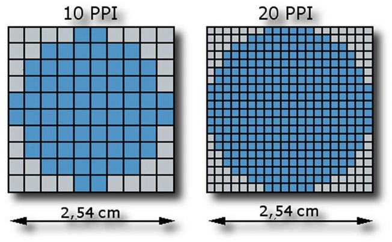

- 每英寸的像素个数
  - 1 英寸 = 2.54 cm
  - 同样 1 英寸宽，10 PPI 有 10 个像素，20 PPI 有 20 个（见上图）
- 密度越高，图像越精细
  - 像素越小越密，边缘越平滑
  - 像素太大时就会出现“马赛克”（见下图）

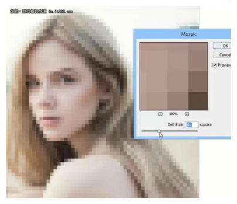

- 屏幕 PPI 的计算
  - PPI = 对角线像素数 ÷ 对角线尺寸（英寸）
  - 例：6.1 英寸、2556×1179 的手机约 460 PPI；27 英寸、2560×1440 的显示器约 109 PPI
- 视网膜屏幕
  - 在正常观看距离上，人眼分辨不出单个像素
  - 视力 5.0 的人看手机（约 30 cm），约 300 PPI 就分辨不出像素点
  - 距离越远，需要的 PPI 越低，所以电脑显示器的 PPI 比手机低

<!-- SLIDE -->


##### 点阵表示

- 点阵表示的思路
  - 把二维平面离散化为网格，每个格子就是一个像素
  - 以颜色编码为基础，记录每个格子的代表性颜色值
- 分辨率
  - 网格的行数和列数，如 1024×768
  - 分辨率越高，网格越密，图像越精细


<!-- SLIDE -->

###### 点阵表示：单色图像

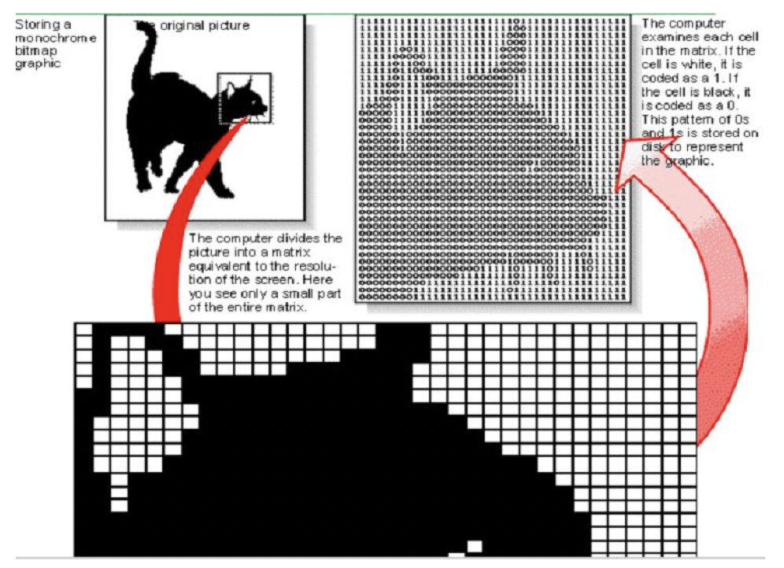

- 单色图像（上图）
  - 每个像素只需 1 位：白色记为 1，黑色记为 0
  - 按行列依次存下这些 0 和 1，就得到整幅图像


<!-- SLIDE -->

###### 点阵表示：彩色图像

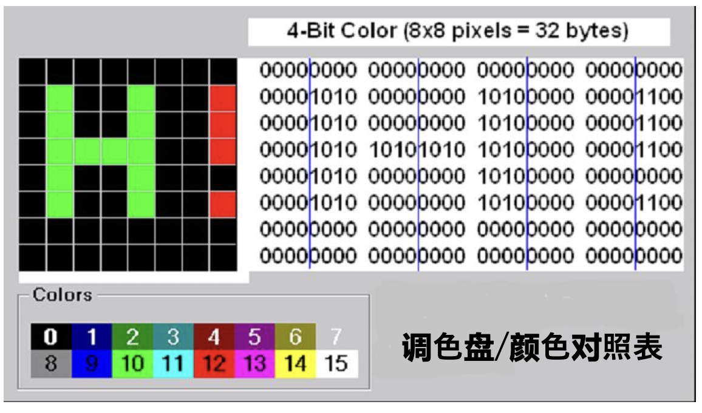

- 4 位彩色图像（上图）
  - 每个像素用 4 位表示颜色编号，按调色盘对照成实际颜色
  - 如绿色编号 10 记为 `1010`，红色编号 12 记为 `1100`
  - 8×8 个像素 × 4 位 = 256 位 = 32 字节

<!-- SLIDE -->


###### 图像质量


- 质量取决于两个因素
  - 分辨率：网格点越多，图像越精细
  - 颜色位数：位数越多，能表示的颜色越多，色彩越真实
- 颜色位数的影响（上图）
  - 同一分辨率下，1 位黑白、4 位 16 色失真明显
  - 8 位 256 色已接近原图，24 位真彩色最逼真
- 质量越高，存储空间越大
  - 存储空间 = 宽 × 高 × 每个像素的字节数
  - 例：4000×3000 的 24 位真彩色图像（每像素 3 字节）
  - 4000 × 3000 × 3 = 36,000,000 Byte ≈ 34 MB
  - 压缩为 JPG 后约 2.9 MB

<!-- SLIDE -->


###### 医学影像：MRI 是什么

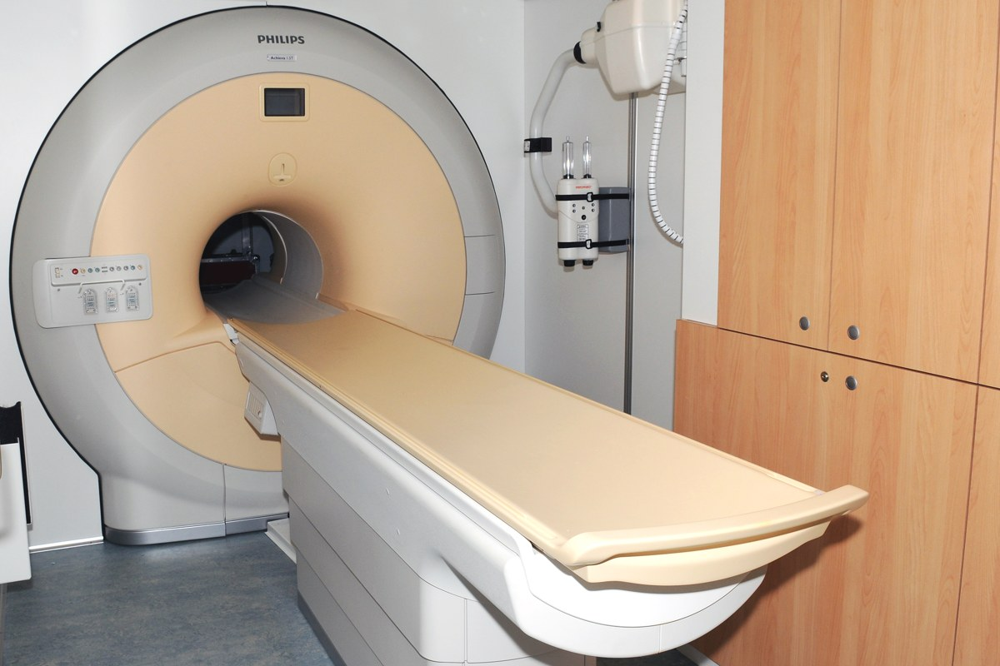


- 磁共振成像
  - 全称 Magnetic Resonance Imaging，简称 MRI
  - 用强磁场和射频脉冲激发人体内的氢原子核
  - 接收它们释放出的信号，再重建成图像
  - 不使用 X 射线，没有电离辐射；CT 测 X 射线衰减，有辐射
- 层与序列
  - 一次成像得到人体某个薄层的截面，称为一层（slice）
  - 用同一套脉冲和参数连续扫若干层，这一叠图像称为一个**序列**（sequence）
  - 换一套参数就是另一个序列，同样的组织明暗随之改变
  - 一次检查要扫多个序列，各自看清不同的结构，合起来才能诊断
  - 一个序列的数据也可以重建出三维图像
- 图像为什么是灰度的
  - 每个像素记录该位置的组织发出的信号强度
  - 信号强弱取决于组织的含水量等性质，本身没有颜色
  - 习惯上强信号显示为白、弱信号显示为黑

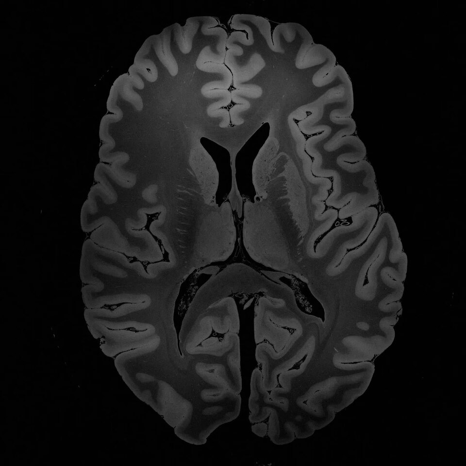

> 上图为研究用的高分辨率图像（7 特斯拉、离体脑标本），临床常规图像的分辨率要低一些。

- 一层有多少像素
  - 采集矩阵：脑 MRI 常用 256×256，也有 320×320、512×512；CT 标准为 512×512
  - 胶片和屏幕上看到的图像是插值放大后的，像素更多但细节不会增加
  - 14×17 英寸胶片按 508 dpi 打印约 6000 万像素，上面排着一二十幅图

<!-- SLIDE -->


###### 例：医学影像 MRI

**例**：头部 MRI 的一个三维序列扫描 180 层，每层 256×256 像素，每个像素用 12 位记录灰度，不压缩需要多少存储空间？

- 灰度用多少位记录
  - MRI 常用 12 位，共 $2^{12} = 4096$ 个灰度级
  - 普通照片的灰度图只有 8 位、256 级
- 为什么要 12 位
  - 人眼一次只能分辨约 100 个灰度级，屏幕也只显示 256 级
  - 阅片时调“窗宽窗位”，就是把关心的那段灰度映射到这 256 级
  - 看脑组织和看骨窗，用的是同一份数据、不同的映射区间
  - 位数不够，软组织之间的细微差别在采集时就被抹掉了
- 存储空间的计算
  - 12 位不足 2 字节，实际按 16 位（2 字节）存放
  - 一层：256 × 256 × 2 = 131,072 字节 = 128 KB
  - 180 层：128 KB × 180 = 23,040 KB ≈ 22.5 MB
  - 若采集矩阵为 512×512，一层就是 512 KB，总量翻两番
- 一次检查远不止这些
  - 上面算的只是一个序列，一次检查要扫多个序列
  - 一次完整的头部 MRI 检查通常在 30～300 MB
  - 512×512、400 层的胸部 CT 约 200 MB
- 医学影像的存储
  - 采用 DICOM 格式：像素数据之外还含患者、设备、扫描参数
  - 医院用 PACS 系统统一存取，数据量以 TB 计
  - 诊断用图像通常只做无损压缩，有损压缩可能抹掉病灶细节

<!-- SLIDE -->


<details>
<summary>复习</summary>

一幅 1024×1024 的点阵图像，其颜色为 24 位真彩色，如果不压缩，该图像至少需要 <mark>3 MB</mark> 存储空间；
假设该图像的颜色数为 200 种，为了压缩存储空间，对每种颜色编号，则 200 种颜色至少需要 <mark>1 字节</mark> 表示；
这时所需存储空间降低至 <mark>1 MB</mark>。(23y)

> - 不压缩：1024 × 1024 × 3 字节 = 3 × $2^{20}$ 字节 = 3 MB
> - 颜色编号：$2^7 = 128 < 200 \le 2^8 = 256$，至少需要 8 位，即 1 字节
> - 编号后：1024 × 1024 × 1 字节 = 1 MB（另需一张调色盘保存 200 种颜色，约 600 字节，可以忽略）

<!-- SLIDE -->

- 以下关于信息编码的说法不正确的是: (23y)
	- A) ASCII 编码了所有的英文字母和常用的标点符号
	- B) <mark>中文字符总是可以用2个字节的二进制数来表示</mark>
	- C) 分辨率为 1024 * 768 的 256 色的图片最少需要占用 786,432 字节的内存来存储
	- <mark>D)十六进制的 1A 和十五进制的 1A 表示的是同一个数值</mark>
  > 对于分辨率为1024*768的256色图片，每个像素的颜色可以通过8位（1字节）来表示，因为2的8次方等于256，正好可以表示256种不同的颜色。
  > 为了计算这种图像所需的存储空间，可以使用以下公式：
  > $ \text{存储空间} = \text{宽度} \times \text{高度} \times \text{每个像素的字节数} $
  > 将给定的值代入公式中：
  > $ \text{存储空间} = 1024 \times 768 \times 1 \, \text{byte} $
  > $ \text{存储空间} = 786,432 \, \text{bytes} $
  >
  > 在某些传统中文编码中，汉字通常用 2 个字节表示；
  > 如 GBK，编码2万多汉字，但它并没有包括所有的中文字符；
  > 有些生僻字并，比如：𠮷（“吉”的异体)在GB2312和GBK中都没有，在GB18030和UTF-8中都采用4字节编码；
  > 如果改成“**常用**中文字符”就对了。

</details>

<!-- SLIDE -->


##### 矢量图形表示


- 点阵表示的不足
  - 只记录每个像素的颜色，不知道画面里有哪些对象（如一条线、一个圆）
  - 要得到高质量的图像，存储量非常大
  - 放大后会出现颗粒感和锯齿
- 矢量图形的思路
  - 把图形分解为直线、曲线等几何对象的集合
  - 每个对象只记录几个参数，用公式描述
  - 如上图：圆只需记录圆心坐标和半径，线段只需记录两个端点的坐标
- 矢量图形的特点
  - 显示时根据画面尺寸，按公式动态计算并画出图形
  - 存储量小，只需很少的数据就能表示一个图形对象
  - 可以任意放大，不会出现颗粒感
- 类比：声音的 MIDI 编码
  - 波形编码记录每个时刻的声波，类似点阵
  - MIDI 只记录“哪个乐器、弹哪个音、多长时间”，播放时再合成声音，类似矢量

<!-- SLIDE -->


###### 二维坐标平面和矢量图形

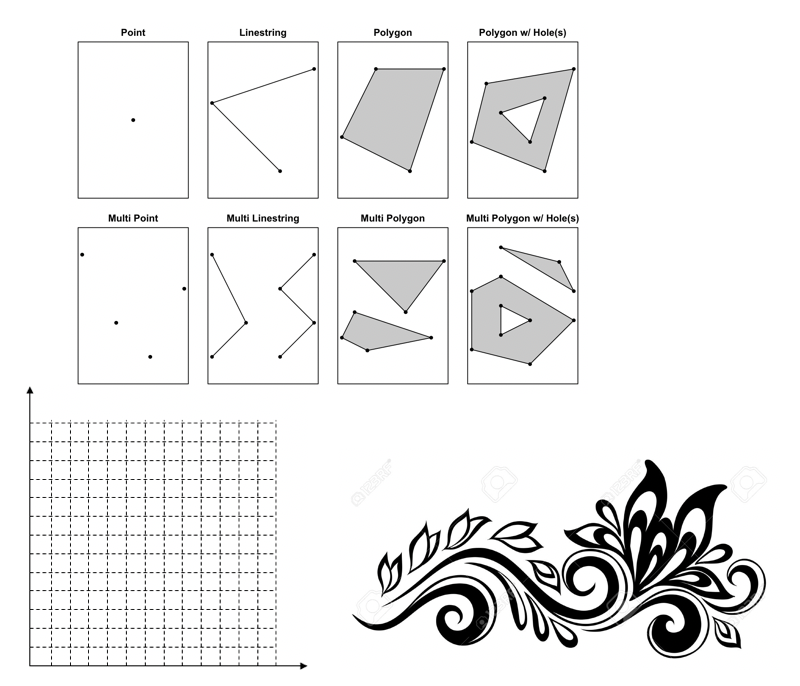

- 用坐标描述点、线、面
  - 在二维坐标平面中，用顶点的坐标表示点
  - 顶点依次连接成线（折线），首尾闭合成面（多边形）
  - 多个点、线、面可以组合，面中还可以挖洞（见上图上半部分）
- 形状的外观
  - 用点符号、线型、填充模式表达形状
  - 再为每个形状指定颜色
- 适用场景
  - 可以绘制高质量图形，任意缩放不失真
  - 适合平面设计、图标、插画、Logo、字体等（见上图下方的花纹）
- 例：SVG 矢量图形文件
  - 网页中常用的 SVG 格式，就是用文本记录图形的坐标和属性

```xml
<svg xmlns="http://www.w3.org/2000/svg" width="200" height="120">
  <circle cx="60" cy="60" r="40" fill="none" stroke="red" stroke-width="6"/>
  <line x1="120" y1="100" x2="190" y2="20" stroke="red" stroke-width="6"/>
</svg>
```

上面几行文字就描述了一个圆（圆心、半径）和一条线段（两个端点），与上一页的例子对应。

<!-- SLIDE -->


<details>
<summary>复习</summary>

在计算机中表示图像的 ______ 表示方法中，图像分解为几何图形的组合。(23y)

> 答案：<mark>矢量</mark>
>
> 点阵表示记录每个像素的颜色；矢量表示把图像分解为直线、曲线、多边形等几何图形，只记录它们的参数。

</details>


<!-- SLIDE -->


###### 字符的字体与字形

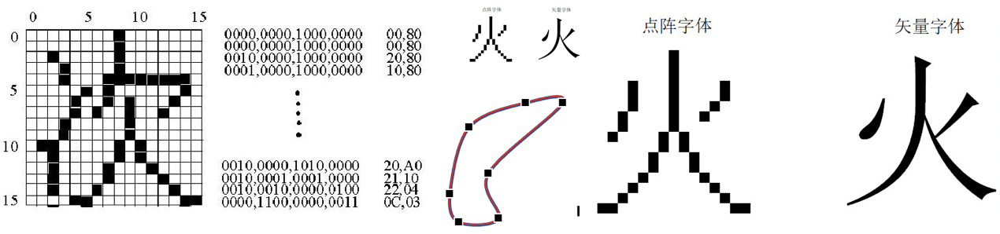

- 字符编码与字形
  - 字符编码（如 Unicode）只规定“是哪个字”
  - 要显示出来，还需要这个字的图像，称为**字形**
  - 同一个字符，选用不同字体，显示出不同字形
- 点阵字体
  - 把字形画在网格上，每个像素 1 位：有笔画为 1，没有为 0
  - 如上图左侧：16×16 点阵，每行 16 位 = 2 字节，一个字共 32 字节
  - 不同字号需要不同分辨率的点阵，放大后有锯齿
- 矢量字体
  - 用轮廓线（直线和曲线）描述笔画，只记录轮廓上的控制点
  - 可以任意缩放，边缘始终平滑
  - 电脑和手机上常用的字体（如 TrueType、OpenType）都是矢量字体
- 与前面内容的联系
  - 点阵字体就是单色点阵图像，矢量字体就是矢量图形

<!-- SLIDE -->


#### 视频编码

- 视频 = 连续的图像 + 声音
  - 数字化视频由一系列数字化图像，加上数字化声音组成
  - 视频中的每一张图像称为一**帧**
- 在时间和空间上离散采样
  - 空间：每一帧是某一时刻场景的点阵图像
  - 时间：按固定间隔连续采集帧，单位是帧/秒（fps）
- 为什么约 24 帧/秒
  - 与人眼的视觉暂留有关：约 24 帧/秒就能感知为连续影像
  - 帧率再低，会有明显的断续感
  - 电影通常为 24 帧/秒，视频常见 25～30 帧/秒，游戏和运动画面更高
- 存储空间非常大
  - 例：一部 1 小时 30 分 17 秒（5417 秒）的电影，1920×1080，24 位真彩色，24 帧/秒，不含声音
  - 1920 × 1080 × 3 字节 × 24 × 5417 = 808,753,766,400 字节 ≈ 753 GB
  - 用 H.264 压缩后约 1.33 GB，只有原来的约 1/566
- 视频压缩是一个非常重要的研究方向

<!-- SLIDE -->

##### 视频的清晰度标准

视频的清晰度主要由**分辨率**（每一帧的像素数）决定，常见标准如下（宽高比均为 16:9，标清除外）：

| 名称 | 常见叫法 | 分辨率 | 像素数 | 相当于 1080p 的 | 未压缩数据量（24 位，30 帧/秒） |
| --- | --- | --- | --- | --- | --- |
| 标清 SD | 480p | 720×480 | 约 35 万 | 0.17 倍 | 约 30 MB/s |
| 高清 HD | 720p | 1280×720 | 约 92 万 | 0.44 倍 | 约 79 MB/s |
| 全高清 FHD | 1080p | 1920×1080 | 约 207 万 | 1 倍 | 约 178 MB/s |
| 2K（QHD） | 1440p | 2560×1440 | 约 369 万 | 1.78 倍 | 约 316 MB/s |
| 4K 超高清 UHD | 2160p | 3840×2160 | 约 829 万 | 4 倍 | 约 712 MB/s |
| 8K 超高清 UHD | 4320p | 7680×4320 | 约 3318 万 | 16 倍 | 约 2848 MB/s |

- 名称的含义
  - “1080p”中的 1080 指垂直方向的像素行数，p 表示逐行扫描（progressive）
  - “4K”“8K”指水平方向约 4000、8000 个像素
- 分辨率每提高一档，数据量成倍增长
  - 4K 的像素数是 1080p 的 4 倍，8K 是 16 倍
  - 未压缩的 4K 视频每秒约 700 MB，必须压缩后才能存储和传输
- 清晰度不只看分辨率
  - 帧率：如 24、30、60 帧/秒，帧率越高，运动画面越流畅
  - 颜色位数：HDR 视频常用每通道 10 位（$2^{10} = 1024$ 级），色彩过渡更细腻
  - 码率：压缩后每秒的数据量，码率越高，画质损失越小

<!-- SLIDE -->


### 数字化原理小结

**数字化**：输入设备把现实世界的信息转换为二进制数据，计算机存储、处理后，再由输出设备还原出来。

| 信息类型 | 数字化方法 | 关键参数 | 例 |
| --- | --- | --- | --- |
| 数值 | 数制转换，原码、反码、补码，浮点数 | 位数 | 8 位补码、IEEE 754 |
| 指令 | 操作码 + 操作数 | 指令长度 | x86 指令 |
| 文字 | 字符集 + 编码方案 | 每字符字节数 | ASCII、GB2312、Unicode（UTF-8） |
| 声音 | 采样、量化、编码（波形编码） | 采样频率、位数、声道 | CD 约 44 kHz、16 bit、双声道 |
| 颜色 | 按位数离散化 | 颜色位数 | RGB 24 位真彩色 |
| 图像 | 点阵（像素）或矢量（几何图形） | 分辨率、颜色位数 | 1920×1080、SVG |
| 视频 | 连续的图像帧 + 声音 | 分辨率、帧率 | 1080p、24 帧/秒 |

- 两类信息，两种思路
  - 有穷的离散信息（数值、指令、文字）：用固定位数的二进制数与之一一对应，n 位可表示 $2^n$ 种
  - 连续的信息（声音、颜色、图像、视频）：先采样、量化，把无穷变为有限，再编码
- 质量与空间的权衡
  - 采样越密、位数越多，越接近原始信息，占用空间也越大
  - 存储空间 ≈ 采样点数 × 每个采样的位数（如声音：时间 × 频率 × 位数 × 声道；图像：宽 × 高 × 每像素位数）
- 压缩必不可少
  - 声音、图像、视频原始数据量很大，需要压缩（MP3、JPG、H.264）
  - 另一种思路是只记录“描述”，需要时再生成：矢量图形、MIDI、矢量字体

<!-- SLIDE -->

## 本章总结

- 数制和数制转换
  - 进位计数制：位置权值 $\sum d_i \times b^i$
  - 十进制转 N 进制：整数除 N 取余，小数乘 N 取整
  - 二进制与八进制、十六进制：每 3 位、4 位直接对应
- 二进制运算与数的表示
  - 算术运算、逻辑运算（与、或、非、异或）、移位运算
  - 整数：原码、反码、补码，计算机普遍采用补码
  - 实数：IEEE 754 浮点数，范围和精度都有限，如 `0.1 + 0.2 != 0.3`
- 计算机中的二进制
  - 容量单位：bit、Byte，二进制前缀（1024）与十进制前缀（1000）
  - 字与字长：CPU 一次处理的位数，现代计算机多为 64 位
- 数字化原理
  - 离散信息（数值、指令、文字）：用固定位数的编码一一对应
  - 连续信息（声音、图像、视频）：采样、量化后再编码
  - 质量越高，数据量越大，需要压缩
- 核心思想
  - 计算机中的一切信息都是二进制数据，含义由编码规则决定
  - 表示方式决定了能表示什么、精度多高、占用多少空间
  - 从现实信息到比特串，是一个**抽象建模**的过程

<!-- SLIDE -->


<!-- END -->

## 更正记录

感谢以下同学对课件的内容提出了宝贵的意见。

- 10/14/2025 2500011730 
  > 单精度浮点数应该是7位有效数字    +0.5
  <!-- 2510306201  贡献加分 0.5 -->
- 1/4/2026 2510306201
  > 改正了“左移/右移”运算中的排版错误 +0.5
  <!-- 2510306201  贡献加分 0.5 -->
